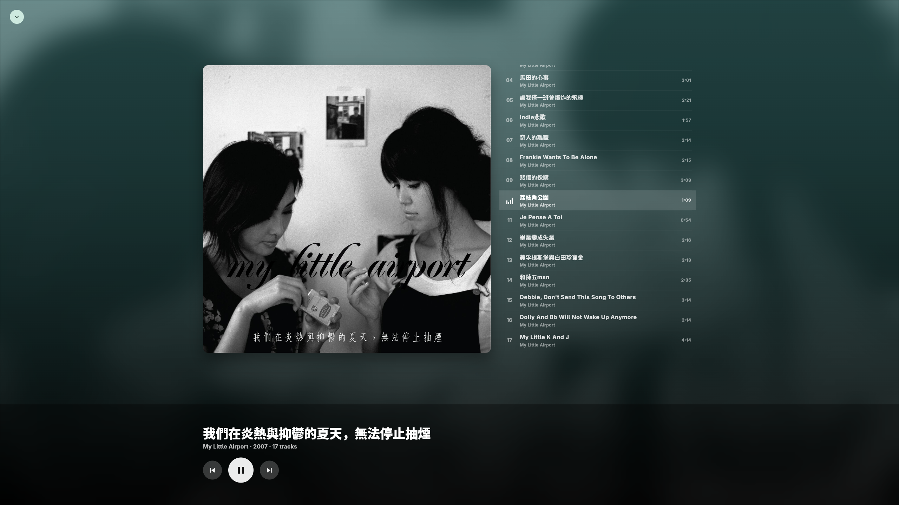

# Miaosic

Miaosic is a Linux-only, local-first FLAC music player. It scans a local music
folder, stores the library in SQLite, caches artwork, and plays tracks with
`media_kit`.

## Screenshots


## Features

- FLAC library scanning through a Rust FFI scanner.
- Album, playlist-folder, and favorite-track browsing.
- SQLite-backed local library state.
- Incremental rescan for fast refreshes after the first scan.
- Full rescan when metadata needs to be force-refreshed.
- Local cover art caching for smooth grids and lists.
- Linux playback through `media_kit`.
- Single-instance guard: launching Miaosic while another instance is already
  running exits immediately instead of starting a second copy.
- Miaosic resumes saved playback on launch, playing even if it was paused.

## Scope

Miaosic is intentionally narrow:

- Supported runtime: Linux.
- Supported library format: `.flac`.
- Android, iOS, macOS, Windows, and web directories are Flutter-generated
  scaffolding only. They are not tested, packaged, or maintained as supported
  targets.

## Library Data

The default music root is:

```text
$HOME/Music
```

The music root can be changed from the Library panel. The selected folder,
scanned library, favorite tracks, and scan state are stored locally in the
platform application support directory. Cover files are cached under `covers/`
in the same app data area.

If a scan reports music file or directory read errors, its result is rejected
and the existing library and favorites are preserved. Fix the reported errors
and retry the scan; unreadable files are not treated as deleted tracks.

## Run

Miaosic requires GTK 3 and `libmpv` at runtime. On Debian or Ubuntu systems,
the following packages provide the development and runtime libraries used by
the build:

```sh
sudo apt install clang cmake libgtk-3-dev fonts-noto-cjk libmpv-dev ninja-build pkg-config xvfb
```

Use Flutter's stable channel, CMake 3.13 or newer, and Rust 1.96.0 to match CI.
Flutter is not pinned to a specific version; run `flutter pub get` after an SDK
update to refresh SDK-dependent packages. The Rust version is selected
automatically through `rust-toolchain.toml`.

Miaosic uses the standard Flutter SDK engine. CD rotation uses an
`AnimationController` and `RotationTransition`, with a separate implicit
animation for the cover's disc shape. Pausing preserves the rotation angle;
resuming continues from it. Animation timing follows Flutter's normal frame
scheduling.

The engine uses Fontconfig for system font fallback. Displaying Chinese requires
a CJK font installed on the system, such as Noto Sans CJK or Source Han Sans.

```sh
flutter run -d linux
```

## Build

```sh
flutter build linux --release
```

The release bundle is written to:

```text
build/linux/x64/release/bundle/
```

The tar bundle includes Miaosic's Rust scanner, Flutter libraries, and SQLite,
but it does not bundle GTK 3 or `libmpv`. Those libraries must be installed on
the target Linux system.

If Flutter reports a stale CMake cache path after moving or copying the checkout,
reset the Linux build directory before rebuilding:

```sh
rm -rf build/linux
flutter build linux --release
```

The app loads only the matching bundled Rust protocol (ABI version 1). Scan
progress, incremental scanning, and cover extraction are required capabilities;
older libraries no longer silently disable features. Native responses and
incremental requests are converted in `lib/rust_scanner_codec.dart`, separately
from database row mappings.

## Code Structure

- `PlaybackController` owns one immutable `PlaybackSession`, including the source,
  track order, and current index. Queue edits also update pending open rollback
  state. UI overlays do not own a separate playback queue.
- `LibraryPlaybackCoordinator` reconciles catalog/favorite changes with playback
  and handles restoration, serialized favorite writes, and playback persistence.
- `LibraryScanTask` owns scan startup, progress, cancellation, and errors.
  `LibraryController` keeps the distinct database policies for direct replacement,
  root changes, and reviewed diffs. Consumers receive a read-only scan listenable.
- The playlist and favorites screens share `CollectionPlaybackDock` and
  `CollectionTrackTable`; their source-specific headings and artwork stay local.
- Widget tests use the real controllers with the shared fake media backend and an
  in-memory SQLite store in `test/support`, rather than reimplementing queue or
  catalog mutations.

## Development Checks

```sh
scripts/check.sh          # formatting, analysis, Clippy, Dart and Rust tests
scripts/check.sh --linux  # also check fonts, build release, and smoke test it
```

CI and the release script use this same entry point. Add `--clean` with
`--linux` to reset the Linux build directory before checking the bundle.
Rust and its required components are selected by `rust-toolchain.toml`.

The script builds the Rust dynamic library before Flutter's scanner integration
tests. A missing library fails the tests instead of skipping them. The Linux
checks require a CJK font, `xvfb-run`, and GNU `timeout`. The bundle smoke test
uses isolated app and runtime directories and requires a rendered first frame
followed by a running process until the test timeout.

The scanner can also be run without opening the UI:

```sh
dart run tool/scan_dev.dart
```

The native Chinese font check runs against the bundled engine (ordinary Flutter
widget tests use the SDK's test engine). Install a CJK font first, then run:

```sh
flutter build linux --release --target tool/font_probe.dart
scripts/check_linux_fonts.sh
flutter build linux --release
```

The last command restores the regular player after building the diagnostic entry
point. CI runs this check before packaging the player.
